  <picture>
    <source media="(prefers-color-scheme: dark)" srcset="./assets/banner-dark.svg" />
    <source media="(prefers-color-scheme: light)" srcset="./assets/banner-light.svg" />
    
  </picture>

   

  
  
  
  

 

### 👋 About Me

I am a PhD candidate in Materials Informatics at Shanghai University, working at the intersection of condensed-matter physics, first-principles calculations, and geometric deep learning. My research focuses on developing symmetry-aware neural networks for electronic structure modeling, inverse crystal design, and autonomous materials discovery.

---

### 🧪 Interactive AI4Science Web Demos

All interactive visualizers below run directly in the browser on GitHub Pages:

| Interactive Tool | Core Capability | Live Access |
| :--- | :--- | :---: |
| **🌐 E3NN Spherical Harmonics Visualizer** | Real-time interactive 3D rendering of (<i>l</i>, <i>m</i>) spherical harmonics basis functions in `E(3)`-equivariant neural networks |  |
| **⚡ DeePAW · Charge Density Predictor** | Sub-angstrom crystalline charge density representation integrating the PAW formalism with `E(3)`-equivariant GNNs |  |
| **💎 CrystaLogic AI** | Deep-learning-assisted 3D crystal structure generation, symmetry inspection, and interactive unit-cell editing |  |
| **📡 Diffraction · Vectorized Matter** | Crystallographic diffraction reconstruction and vectorized reciprocal-space exploration |  |
| **🧬 NeuroCell · Bio-Digital Interface** | Immersive neural-microscopic generative visual interface |  |

---

### 🧊 Contribution Field

  <picture>
    <source media="(prefers-color-scheme: dark)" srcset="https://raw.githubusercontent.com/SuthPhy2Ai/SuthPhy2Ai/output/crystal-lattice-dark.svg" />
    <source media="(prefers-color-scheme: light)" srcset="https://raw.githubusercontent.com/SuthPhy2Ai/SuthPhy2Ai/output/crystal-lattice-light.svg" />
    
  </picture>

---

### 📄 Selected & Latest Publications

<!-- ORCID-PUBS:START -->
- `2026.11` · [**Learning Work Function via Implicit Reasoning on Electrostatic Potential Landscapes**](https://doi.org/10.1002/advs.77166) — *Advanced Science*
- `2026.09` · [**Single-atom edge site evolution in layered supports: a first-principles investigation**](https://doi.org/10.1007/s11426-026-3661-8) — *Science China Chemistry*
- `2026.08` · [**A comprehensive Hirshfeld and iterative-Hirshfeld dataset for 5080 inorganic materials from first-principles calculations**](https://doi.org/10.1016/j.dib.2026.113228) — *Data in Brief*
- `2026.07` · [**CLRe: A Synergistic Dual‐Engine Framework for One‐Step Retrosynthesis Prediction**](https://doi.org/10.1002/advs.76827) — *Advanced Science*
- `2026` · [**Engineering acid-tolerant RuO2 through dual modulation of d-band center and local proton environment for stable oxygen evolution reaction**](https://doi.org/10.1016/j.cej.2026.181481) — *Chemical Engineering Journal*
- `2025.05` · [**Physics-guided deep learning strategy for 2D structure reconstruction from diffraction patterns**](https://doi.org/10.1038/s42005-025-02152-8) — *Communications Physics*
- `2025.05` · [**Interpretable Active Learning Identifies Iron‐Doped Carbon Dots With High Photothermal Conversion Efficiency for Antitumor Synergistic Therapy**](https://doi.org/10.1002/agt2.70060) — *Aggregate*
- `2024.12` · [**Kolmogorov–Arnold Network Made Learning Physics Laws Simple**](https://doi.org/10.1021/acs.jpclett.4c02589) — *The Journal of Physical Chemistry Letters*

<b>📚 View Earlier Publications (13 more · PRB, APL, IUCrJ, Mat. Des., JPCL, ...)</b>

- `2024.12` · [**Machine Learning‐Engineered Nanozyme System for Synergistic Anti‐Tumor Ferroptosis/Apoptosis Therapy**](https://doi.org/10.1002/smll.202408750) — *Small*
- `2024.11` · [**CGWGAN: crystal generative framework based on Wyckoff generative adversarial network**](https://doi.org/10.20517/jmi.2024.24) — *Journal of Materials Informatics*
- `2024.07` · [**Crystallographic phase identifier of a convolutional self-attention neural network (CPICANN) on powder diffraction patterns**](https://doi.org/10.1107/s2052252524005323) — *IUCrJ*
- `2024.05` · [**Active learning accelerates the discovery of high strength and high ductility lead-free solder alloys**](https://doi.org/10.1016/j.matdes.2024.112921) — *Materials & Design*
- `2023.08` · [**Magnetic transitions of hydrogenated HxCrO2 (x = 0–2) monolayer from a ferromagnetic half-metal to antiferromagnetic insulator**](https://doi.org/10.1088/1361-648x/acccc6) — *Journal of Physics: Condensed Matter*
- `2023.07` · [**Electric field and charge doping induced superconducting transition in 2D freestanding perovskite barium bismuthate**](https://doi.org/10.1007/s11433-022-2088-3) — *Science China Physics, Mechanics & Astronomy*
- `2023` · [**Cuprate superconducting materials above liquid nitrogen temperature from machine learning**](https://doi.org/10.1039/D3RA02848H) — *RSC Advances*
- `2022.12` · [**Accurate band gap prediction based on an interpretable Δ-machine learning**](https://doi.org/10.1016/j.mtcomm.2022.104630) — *Materials Today Communications*
- `2022.10` · [**Volume-matched piezoelectric LaN/REN superlattices from first-principles**](https://doi.org/10.1063/5.0116230) — *Applied Physics Letters*
- `2022.08` · [**Strain-induced ferroelectricity and piezoelectricity in centrosymmetric binary oxides**](https://doi.org/10.1103/PhysRevB.106.064106) — *Physical Review B*
- `2021.09` · [**Physics-Based Feature Makes Machine Learning Cognizing Crystal Properties Simple**](https://doi.org/10.1021/acs.jpclett.1c02273) — *The Journal of Physical Chemistry Letters*
- `2021.09` · [**Volume-matched ferroelectric and piezoelectric ZnO/MgO superlattice**](https://doi.org/10.1016/j.jallcom.2021.160167) — *Journal of Alloys and Compounds*
- `2021.03` · [**Ferroic properties and piezoelectric response of Mg2XN3 (X = V, Cr)**](https://doi.org/10.1063/5.0044496) — *Applied Physics Letters*

🔄 Auto-synced from <a href="https://orcid.org/0000-0003-3092-2535">ORCID (0000-0003-3092-2535)</a> · Total indexed works: <b>21</b>
<!-- ORCID-PUBS:END -->
